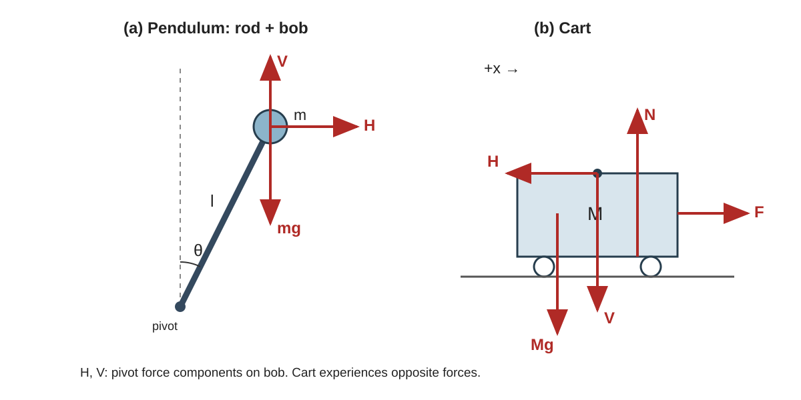

# From the fixed pivot to cart-pendulum control

This is an optional extension. The main problem has a fixed pivot and an angle measured from **downward** vertical. Here the pivot rides on a cart, and the angle is measured from **upward** vertical. Keep that change in mind; copying signs between the two models is a common mistake.

## 1. Define the cart model

Let the cart mass be $M$, bob mass $m$, and rod length $l$. The rod is massless and rigid. The cart has no vertical motion or horizontal friction. The pivot is frictionless. Let $x$ increase to the right. Let $\theta=0$ mean upright, with a lean to the right positive. The applied cart force $F$ is positive to the right.

On the bob, call the pivot-force components $H$ rightwards and $V$ upwards; gravity is $mg$ downwards. On the cart the corresponding reactions are $-H$ and $-V$, alongside $F$, cart weight $Mg$, and ground normal force $N$. The arrows define positive components; negative answers indicate opposite directions. Because the rod is massless and has forces only at its ends, its resultant force is along the rod. $H$ and $V$ are components of that force, not independent actuators.

The bob coordinates are

$$x_b=x+l\sin\theta,\qquad y_b=l\cos\theta.$$

Differentiate twice, retaining the product-rule terms:

$$\ddot x_b=\ddot x+l\cos\theta\ddot\theta-l\sin\theta\dot\theta^2,$$
$$\ddot y_b=-l\sin\theta\ddot\theta-l\cos\theta\dot\theta^2.$$

Newton's law for each isolated body gives

$$H=m\ddot x_b,\qquad V-mg=m\ddot y_b,$$
$$F-H=M\ddot x,\qquad N-Mg-V=0.$$

Substitute the first equation into the cart equation:

$$\boxed{(M+m)\ddot x+ml\cos\theta\ddot\theta-ml\sin\theta\dot\theta^2=F.}$$

The tangent direction for increasing $\theta$ is $(\cos\theta,-\sin\theta)$. The rod force has zero tangential component; gravity contributes $mg\sin\theta$. Projecting acceleration onto that tangent gives $\ddot x\cos\theta+l\ddot\theta$. Thus

$$mg\sin\theta=m(\ddot x\cos\theta+l\ddot\theta),$$

or

$$\boxed{ml\cos\theta\ddot x+ml^2\ddot\theta-mgl\sin\theta=0.}$$

These are the coupled nonlinear equations. They also show why a force applied to the cart cannot simply be treated as the same force applied to the bob.

## 2. Linearize near upright

For small angles and small velocities near rest, use $\sin\theta\approx\theta$, $\cos\theta\approx1$, and discard the higher-order $\theta\dot\theta^2$ term. Then

$$ (M+m)\ddot x+ml\ddot\theta=F,$$
$$ \ddot x+l\ddot\theta-g\theta=0.$$

Substitution yields

$$\boxed{\ddot x=\frac{F-mg\theta}{M},\qquad
\ddot\theta=\frac{(M+m)g}{Ml}\theta-\frac{F}{Ml}.}$$

$\ddot\theta$ is the rod's angular acceleration relative to a nonrotating vertical reference. A frame translating with the cart measures the same angular acceleration, but force equations in that accelerating frame require a pseudo-force.

The positive gravity term makes upright unstable. A rightward cart force contributes a negative angular acceleration. This is an acceleration statement: a bob already falling right may first slow down before reversing. Cart velocity need not initially point in the same direction as its acceleration.

For $M=3$ kg, $m=0.5$ kg, $l=1$ m, $g=9.81$ m/s², and $\theta=0.1$ rad:

$$\ddot\theta=1.1445-\frac F3.$$

With $F=4$ N, $\ddot\theta\approx-0.18883$ rad/s². Those parameter values belong to this teaching example, not to the main fixed-pivot assignment.

If an elevation angle $\phi$ is measured from the rightward horizontal instead, $\phi=\pi/2-\theta$, so $\ddot\phi=-\ddot\theta$. Directly, the nonlinear relation is

$$\ddot\phi=\frac{\ddot x\sin\phi-g\cos\phi}{l}.$$

## 3. Why consider PD or PID?

Taking Laplace transforms with zero initial conditions gives

$$\frac{\Theta(s)}{F(s)}=\frac{-1}{Ml s^2-(M+m)g}.$$

There is a pole at $+\sqrt{(M+m)g/(Ml)}$, confirming local open-loop instability.

With our sign convention, choose angle feedback $F=K_p\theta+K_d\dot\theta$. Substitution gives

$$Ml\ddot\theta+K_d\dot\theta+[K_p-(M+m)g]\theta=0.$$

The ideal linear angle subsystem is asymptotically stable when $K_d>0$ and $K_p>(M+m)g$. P alone supplies no damping in this model. Adding $K_i\int\theta\,dt$ produces characteristic polynomial

$$Ml s^3+K_d s^2+[K_p-(M+m)g]s+K_i.$$

For positive gains, the Routh conditions additionally require

$$K_d[K_p-(M+m)g]>Ml K_i.$$

So adding integral action does not automatically improve stability. Also, stabilizing angle alone does not guarantee that the cart returns to the origin. That objective motivates feedback from the complete state.

## 4. Build the state-space model

Use $\mathbf z=[x,\dot x,\theta,\dot\theta]^T$. The linearized model is $\dot{\mathbf z}=A\mathbf z+BF$, with

$$A=\begin{bmatrix}
0&1&0&0\\
0&0&-mg/M&0\\
0&0&0&1\\
0&0&(M+m)g/(Ml)&0
\end{bmatrix},\qquad
B=\begin{bmatrix}0\\1/M\\0\\-1/(Ml)\end{bmatrix}.$$

Each row simply states the derivative of one state. The first and third rows are definitions of velocity; the other two come from the acceleration equations.

## 5. Derive the LQR feedback law

Choose a symmetric state penalty $Q\succeq0$ and scalar force penalty $R>0$:

$$J=\int_0^\infty(\mathbf z^TQ\mathbf z+RF^2)\,dt.$$

For diagonal $Q$, its entries weight squared cart position, cart velocity, angle, and angular velocity. The terms have different physical units, so weights should be chosen with meaningful state and force scales. Making $R$ larger penalizes force more strongly. LQR balances these penalties over the whole future trajectory.

Let $V(\mathbf z)$ be the smallest remaining cost from the current state. For this linear-quadratic problem, seek $V=\mathbf z^TP\mathbf z$ with symmetric $P$. Over a short interval $dt$, optimality says current cost plus optimal future cost must equal the current value. Expanding the future value to first order gives the stationary Hamilton–Jacobi–Bellman equation:

$$0=\min_F\left[\mathbf z^TQ\mathbf z+RF^2+2\mathbf z^TP(A\mathbf z+BF)\right].$$

Differentiate the expression with respect to the scalar force:

$$2RF+2B^TP\mathbf z=0.$$

Because $R>0$, the expression is convex in $F$, and its stationary point is its minimum:

$$\boxed{F^*=-R^{-1}B^TP\mathbf z=-K\mathbf z.}$$

Substitute that force back into the HJB equation. Using $2\mathbf z^TPA\mathbf z=\mathbf z^T(PA+A^TP)\mathbf z$, collect terms to obtain

$$0=\mathbf z^T[Q+A^TP+PA-PBR^{-1}B^TP]\mathbf z.$$

For this to hold for every state, the bracketed symmetric matrix must vanish:

$$\boxed{A^TP+PA-PBR^{-1}B^TP+Q=0.}$$

This is the continuous-time algebraic Riccati equation. Under stabilizability of $(A,B)$ and detectability of $(Q^{1/2},A)$, its stabilizing solution gives $K=R^{-1}B^TP$ and closed-loop dynamics

$$\boxed{\dot{\mathbf z}=(A-BK)\mathbf z.}$$

The resulting linear closed loop is stable. This does not provide a global guarantee for the nonlinear pendulum, arbitrary initial angles, actuator saturation, or measurement errors. Those require further analysis and testing. This appendix is a theoretical derivation; the repository's saved simulation results are for the fixed-pivot problem only.

For a broader treatment, see [MIT Underactuated Robotics: LQR](https://underactuated.mit.edu/lqr.html).
