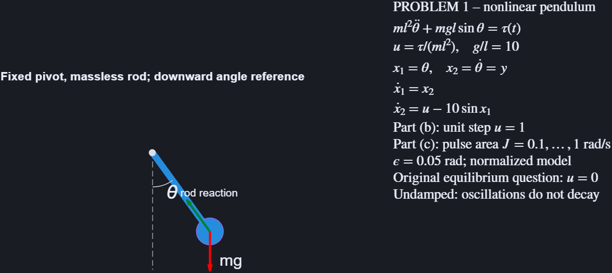
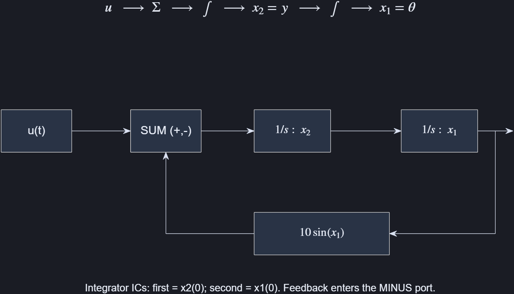
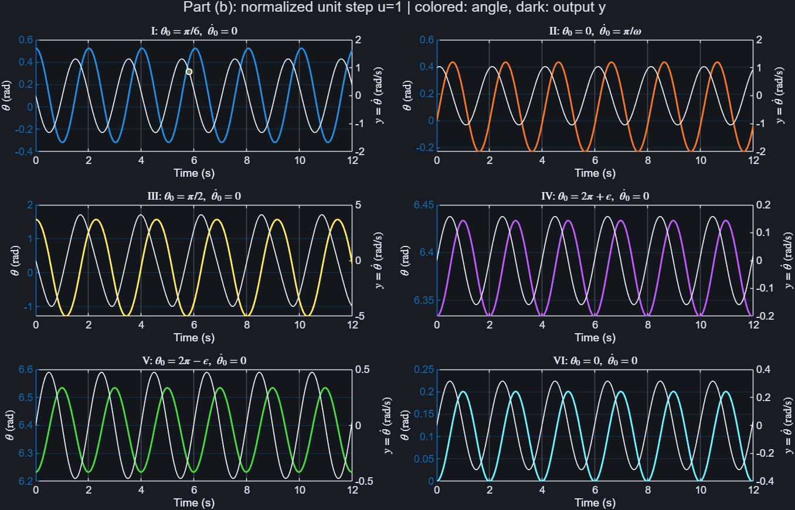
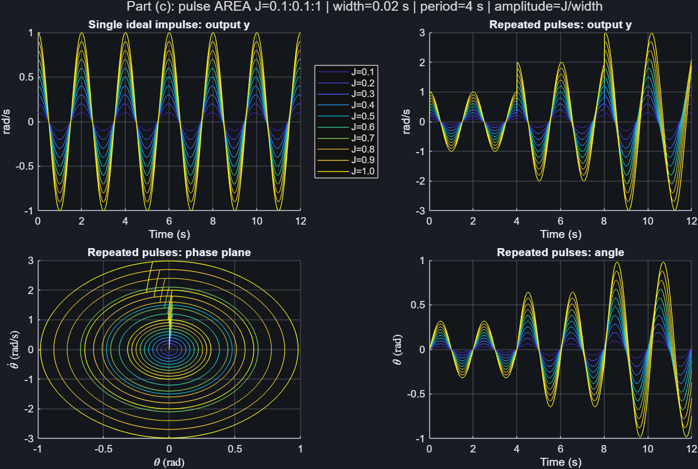
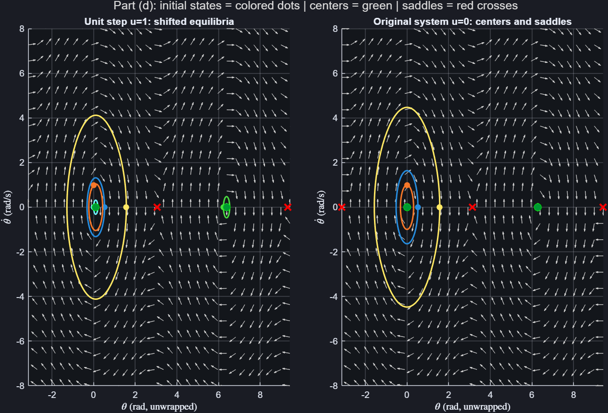
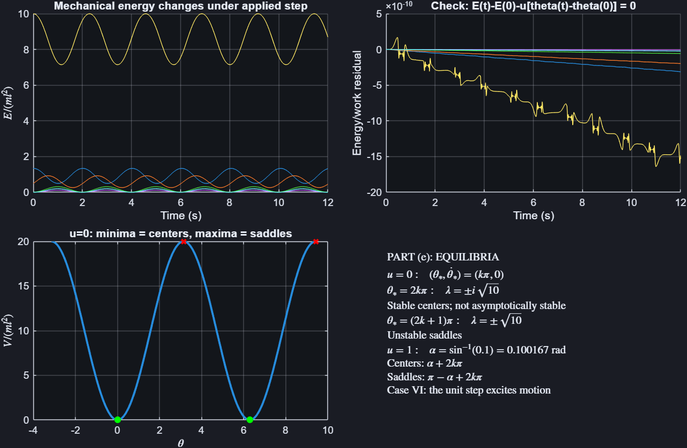
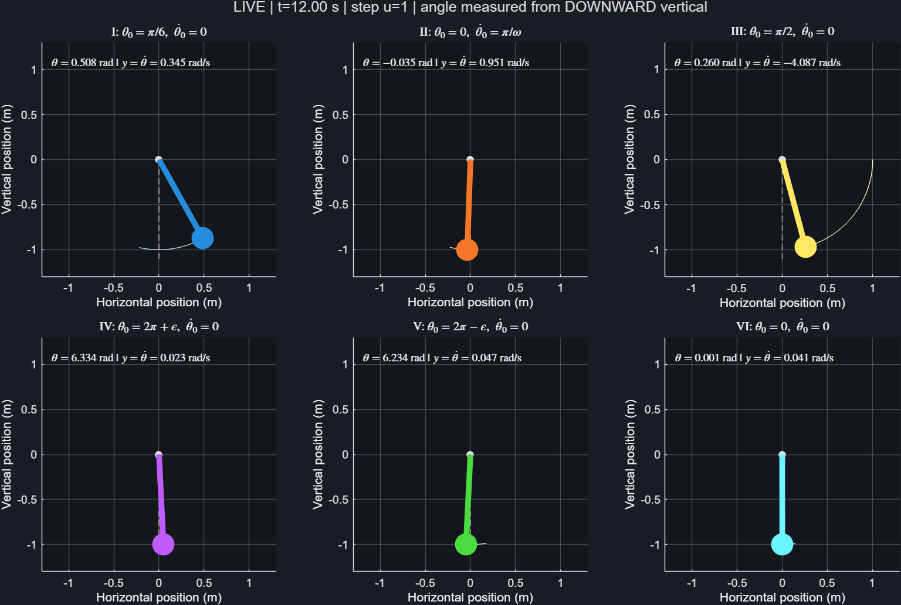

# Pendulum Control Problem

A worked nonlinear-pendulum problem, from the force balance to MATLAB plots. The aim is to make every equation explainable, rather than just produce a set of graphs.

## The problem

A point mass hangs from a rigid, massless rod attached to a fixed pivot. There is no friction or damping. Its unforced motion is described by

```math
ml^2\ddot\theta+mgl\sin\theta=0,
```

with $g=10\ \mathrm{m/s^2}$, $l=1\ \mathrm m$, and $\omega^2=g/l$.

Here, **the angle is measured from the downward vertical**. Zero means the bob is hanging straight down; $\pi$ means it is directly above the pivot. The output required by the problem is angular velocity, not angle.

The tasks are:

1. Define $x_1=\theta$ and $x_2=\dot\theta=y$, and construct an integrator-based block diagram.
2. Examine the response for these six initial conditions:

| Case | $x_1(0)$, rad | $x_2(0)$, rad/s |
|---|---:|---:|
| I | $\pi/6$ | $0$ |
| II | $0$ | $\pi/\omega$ |
| III | $\pi/2$ | $0$ |
| IV | $2\pi+\epsilon$ | $0$ |
| V | $2\pi-\epsilon$ | $0$ |
| VI | $0$ | $0$ |

3. Apply pulses with strengths from 0.1 to 1 and examine the response.
4. Draw phase-plane trajectories for the initial conditions.
5. Find the equilibrium points and classify their stability.

### Input conventions used in this solution

The equation above has no input. To study an actual step response, we explicitly extend it to a driven pendulum:

```math
ml^2\ddot\theta+mgl\sin\theta=\tau(t),\qquad u(t)=\frac{\tau(t)}{ml^2}.
```

Part (b) uses a **normalized unit step**, $u(t)=1$ for $t\ge0$. This input has units of angular acceleration; it is not automatically a one-newton-metre torque. The original unforced model is retained for comparison and for the original equilibrium question.

The unspecified small displacement is set to $\epsilon=0.05$ rad. Pulse strength means normalized **area**, with width 0.02 s and repetition period 4 s. These choices are stated assumptions, not additional data from the question. Case II is read literally as $\pi/\omega$, evaluated numerically as an initial velocity in rad/s. As written, that expression needs an implicit dimensional scale: $1/\omega$ by itself has units of time.

This is a fixed-pivot problem. The moving-cart model and controller discussion appear separately in [the optional appendix](CONTROL_APPENDIX.md).

## 1. Start with the forces



The bob experiences gravity and a force from the rod. Resolve the forces into a direction along the rod and a direction perpendicular to it. The perpendicular direction is the useful one: motion along the circular path changes the angle, while the rod force has no component in that direction.

Taking increasing $\theta$ as positive, gravity has tangential component $-mg\sin\theta$. The minus sign matters. For a small positive angle, gravity pulls the bob back towards zero.

Tangential acceleration relative to the fixed pivot is $l\ddot\theta$. Newton's law therefore gives

```math
ml\ddot\theta=-mg\sin\theta.
```

Multiply by $l$ to obtain the torque equation:

```math
ml^2\ddot\theta=-mgl\sin\theta.
```

An applied pivot torque adds $\tau$ to the right-hand side:

```math
ml^2\ddot\theta=\tau-mgl\sin\theta.
```

Dividing by $ml^2$ gives the model used for simulation:

```math
\boxed{\ddot\theta=u-\frac gl\sin\theta=u-10\sin\theta.}
```

We have not used $\sin\theta\approx\theta$. The simulated model is nonlinear, including the 90-degree initial displacement in Case III.

## 2. Part (a): turn one second-order equation into two first-order equations

A state is a quantity we need to know now to predict what happens next. Angle alone is insufficient: a bob at the same angle can be moving left, moving right, or momentarily stationary. So choose angle and angular velocity:

```math
x_1=\theta,\qquad x_2=\dot\theta.
```

Differentiate each definition:

```math
\dot x_1=\dot\theta=x_2,
```

```math
\dot x_2=\ddot\theta=u-10\sin x_1.
```

The output is specified as $y=x_2$. Thus

```math
\boxed{\dot x_1=x_2,\quad\dot x_2=u-10\sin x_1,\quad y=x_2.}
```



Read the diagram from left to right. The summing junction produces acceleration. Integrating acceleration gives velocity. Integrating velocity gives angle. Feed angle through a sine block and gain 10, then return it to the **negative** input of the summing junction.

The first integrator starts at $x_2(0)$; the second starts at $x_1(0)$. Initial conditions are stored states, not extra input forces. Interchanging these integrator initial conditions produces a different physical experiment.

## 3. Part (b): apply the step and inspect all six cases

For $t\ge0$, substitute $u=1$:

```math
\dot x_1=x_2,\qquad\dot x_2=1-10\sin x_1.
```

A finite step changes acceleration immediately, but angle and velocity remain continuous. Contrast this with the ideal impulse in Part (c), which causes a velocity jump.

Before looking at a plot, calculate the initial acceleration:

```math
\ddot\theta(0^+)=1-10\sin\theta(0).
```

| Case | Initial acceleration, rad/s² | What to expect initially |
|---|---:|---|
| I | $1-10(1/2)=-4$ | Angle starts decreasing from rest. |
| II | $1$ | Already moving positively; positive acceleration initially increases that velocity. |
| III | $1-10=-9$ | Strong restoring acceleration from a large displacement. |
| IV | $1-10\sin(0.05)\approx0.500208$ | Moves towards the shifted center above $2\pi$. |
| V | $1+10\sin(0.05)\approx1.499792$ | Also accelerates positively, with a larger magnitude. |
| VI | $1$ | Starts moving even though both initial states are zero. |

This is an easy way to check signs. In particular, Case VI cannot remain motionless under a nonzero step.



The colored curve uses the left axis and shows angle. The pale curve uses the right axis and shows $y=\dot\theta$. Do not compare their heights without checking the two scales.

The step shifts the local resting angle. Set velocity and acceleration to zero:

```math
1-10\sin\theta_s=0\quad\Rightarrow\quad\sin\theta_s=0.1.
```

The center near zero is

```math
\theta_s=\sin^{-1}(0.1)\approx0.100167\ \mathrm{rad}=5.739^\circ.
```

The corresponding center near one complete revolution is $2\pi+0.100167$. Cases IV and V therefore are not symmetric about $2\pi$ under the step.

There is no damping, so the bounded motions in these examples keep oscillating rather than settling. The numerical record covers 12 seconds. Angles are left unwrapped: $2\pi+\epsilon$ stays near $2\pi$ in the graphs, although it represents the same physical orientation as $\epsilon$.

### A small-motion approximation we can solve by hand

Write $\theta=\theta_s+\eta$, where $\eta$ is a small displacement from the shifted center. Expand the sine to first order:

```math
\sin(\theta_s+\eta)\approx\sin\theta_s+\eta\cos\theta_s.
```

Because $10\sin\theta_s=1$, the constant terms cancel:

```math
\ddot\eta+10\cos\theta_s\,\eta=0.
```

Define $\Omega=\sqrt{10\cos\theta_s}\approx3.15434\ \mathrm{rad/s}$. Then

```math
\eta(t)=\eta(0)\cos\Omega t+\frac{\dot\eta(0)}{\Omega}\sin\Omega t.
```

For Case VI, $\eta(0)=-\theta_s$ and $\dot\eta(0)=0$, so

```math
\theta(t)\approx\theta_s(1-\cos\Omega t),\qquad\dot\theta(t)\approx\theta_s\Omega\sin\Omega t.
```

This predicts an angle swinging approximately between zero and $2\theta_s\approx0.200335$ rad, and a velocity amplitude around 0.316 rad/s. That agrees with the scale of the nonlinear plot. It is a local approximation, not the equation used to generate the graphs.

## 4. Derive energy before interpreting the phase plane

The bob's speed is $l\dot\theta$, so kinetic energy is

```math
T=\frac12ml^2\dot\theta^2.
```

Relative to the bottom position, the rise in height is $l(1-\cos\theta)$. Potential energy is

```math
V=mgl(1-\cos\theta).
```

Divide total energy by $ml^2$ and call the result $\mathcal E$:

```math
\mathcal E=\frac12\dot\theta^2+10(1-\cos\theta).
```

Differentiate carefully:

```math
\frac{d\mathcal E}{dt}=\dot\theta\ddot\theta+10\sin\theta\dot\theta
=\dot\theta(\ddot\theta+10\sin\theta)=u\dot\theta.
```

For $u=0$, this derivative is zero. For a constant input $U$, it need not be zero: the applied torque does work. Instead,

```math
\boxed{H=\mathcal E-U\theta\quad\text{is constant}.}
```

Equivalently, $\mathcal E(t)-\mathcal E(0)=U[\theta(t)-\theta(0)]$. This identity is also used to check the numerical solution.

An exact implicit time relation follows by solving for velocity:

```math
\dot\theta=\pm\sqrt{2[H_0-10(1-\cos\theta)+U\theta]}.
```

On a segment with a fixed velocity sign,

```math
t-t_0=\int_{\theta_0}^{\theta}\frac{dq}{\pm\sqrt{2[H_0-10(1-\cos q)+Uq]}}.
```

At a turning point the direction changes, so the appropriate sign must change. This explains why numerical integration is useful: the full nonlinear solution is not generally an elementary sine wave.

## 5. Part (c): understand the kick before simulating it

Let $u(t)=J\delta(t)$ be an ideal normalized impulse. Integrate the equation across its very short action:

```math
\int_{0^-}^{0^+}\ddot\theta\,dt=\int_{0^-}^{0^+}J\delta(t)\,dt-10\int_{0^-}^{0^+}\sin\theta\,dt.
```

The last integral tends to zero because the sine is bounded and the time interval tends to zero. Therefore

```math
\boxed{\dot\theta(0^+)-\dot\theta(0^-)=J.}
```

Angle remains continuous. Starting from rest at the bottom, we can simulate the impulse response by starting the unforced model at $(\theta,\dot\theta)=(0,J)$.

A real pulse is finite. For a rectangular pulse of width $\Delta$, choose amplitude $A=J/\Delta$, because its area is $A\Delta=J$. Here $\Delta=0.02$ s, so areas 0.1 through 1 correspond to amplitudes 5 through 50 rad/s². A pulse whose **amplitude** is 0.1 is a different input from a pulse whose **area** is 0.1.



The first panel is a single ideal impulse. The other panels use a train of finite pulses, one every four seconds. Each experiment starts from rest; the unit step is not added to the pulse input. Integration is split at every pulse edge so the solver cannot jump over a narrow pulse.

For one ideal kick from the bottom, $\mathcal E=J^2/2$. The top of the circle has potential energy $10(1-\cos\pi)=20$. Thus the critical kick satisfies

```math
\frac12J_c^2=20\quad\Rightarrow\quad J_c=\sqrt{40}\approx6.32456\ \mathrm{rad/s}.
```

At exactly that energy, the ideal trajectory approaches the upright equilibrium asymptotically. Sustained rotation requires energy above the barrier. All the single kicks here are below it.

For $J=1$, the turning angle satisfies $10(1-\cos\theta_{\max})=1/2$, giving $\theta_{\max}=\cos^{-1}(0.95)\approx0.31756$ rad. Repeated kicks are different: a positive kick can either add or remove energy depending on the current velocity. Exactly, a kick changes energy by $\Delta\mathcal E=J\dot\theta^-+J^2/2$.

## 6. Part (d): read the phase plane



The horizontal coordinate is angle; the vertical coordinate is angular velocity. One point describes the complete instantaneous state. A trajectory shows how that state moves over time.

At each point the vector field is

```math
\begin{bmatrix}\dot x_1\\\dot x_2\end{bmatrix}=\begin{bmatrix}x_2\\U-10\sin x_1\end{bmatrix}.
```

Above the horizontal axis, $x_2>0$, so trajectories move right. Below it, they move left. On the axis, the acceleration decides whether the next motion points up or down. The arrows in the plot are normalized to make their directions readable; their lengths are not acceleration measurements.

For the original $U=0$ system, energy contours satisfy

```math
x_2=\pm\sqrt{2[\mathcal E-10(1-\cos x_1)]}.
```

Below energy 20, trajectories form closed oscillation loops. Energy 20 gives the separatrix through the upright saddles. Above 20, the unwrapped angle can keep increasing or decreasing. The left panel uses the step input; its contours come from $H$, and its equilibria shift. The right panel shows the original unforced system.

## 7. Part (e): find and classify equilibria

An equilibrium requires **both** state derivatives to vanish. For the original model:

```math
x_2^{\ast}=0,\qquad-10\sin x_1^{\ast}=0.
```

Hence

```math
\boxed{(x_1^{\ast},x_2^{\ast})=(k\pi,0),\qquad k\in\mathbb Z.}
```

To see what happens nearby, write $x_1=x_1^{\ast}+\eta$. Linearizing gives $\ddot\eta=-10\cos x_1^{\ast}\eta$. The equivalent Jacobian is

```math
A_* =\begin{bmatrix}0&1\\-10\cos x_1^{\ast}&0\end{bmatrix},\qquad\lambda^2+10\cos x_1^{\ast}=0.
```

At $x_1^{\ast}=2k\pi$, the eigenvalues are $\pm i\sqrt{10}$. Nearby motion oscillates. To establish nonlinear stability, use energy: it has a strict local minimum there, and it is conserved. These are stable centers, but they are **not asymptotically stable**, because nearby trajectories do not lose energy and approach the equilibrium.

At $x_1^{\ast}=(2k+1)\pi$, the eigenvalues are $\pm\sqrt{10}$. One direction grows exponentially. These are unstable saddles.

For the constant unit step, replace the equilibrium condition by $\sin\theta^{\ast}=0.1$. With $\alpha=\sin^{-1}(0.1)$, the centers are $(\alpha+2k\pi,0)$ and the saddles are $(\pi-\alpha+2k\pi,0)$. Their local classification follows from the sign of $\cos\theta^{\ast}$. More generally, constant-input equilibria exist only when $|U|\le10$; the boundary cases $|U|=10$ are degenerate and require separate analysis.



## 8. Run the MATLAB solution

The saved figures were generated with MATLAB R2025b. The dark-theme code targets that release; older MATLAB releases may need their figure-theme settings adapted. Base MATLAB is sufficient for the numerical solution. Simulink is optional.

Put the four `.m` files in one folder, open that folder in MATLAB, and run:

```matlab
problem_1
```

The script displays the model, block diagram, six step responses, phase planes, pulse responses, and energy checks in sequence. It then animates all six pendulums together. Use the replay button, or run `replay_problem_1` after the data have been generated. New data, editable figures, PNGs, and the MP4 are written to `outputs/`.



[Watch or download the saved animation](problem_1_animation.mp4).

`build_problem_1_simulink.m` can generate an actual block model when Simulink is installed and licensed. That model builder has not been executed in the environment used for these results, so a tested `.slx` is not claimed here. The MATLAB block-diagram image is an explanation of the signal flow.

The ODE solver uses relative tolerance $10^{-10}$, absolute tolerance $10^{-12}$, and maximum step 0.01 s. The largest energy/work residual across the six step cases was approximately $1.64\times10^{-9}$, below the $10^{-6}$ check. The individual values are in [verification.csv](verification.csv). This is a numerical consistency check, not experimental validation of a real apparatus.

## Things worth trying next

- Set $U=0$ and check that Case VI stays still.
- Add damping, $\ddot\theta+b\dot\theta+10\sin\theta=u$, with a declared normalized damping coefficient $b>0$. Watch closed phase loops become spirals.
- Change pulse width while keeping area fixed, then compare with the ideal kick.
- Increase the initial speed beyond $\sqrt{40}$ in the unforced model and look for rotation.
- Read [the cart-pendulum and LQR appendix](CONTROL_APPENDIX.md) before adding a moving base or a balancing controller.

## Further reading

[MIT Underactuated Robotics: The Simple Pendulum](https://underactuated.mit.edu/pend.html) develops the energy and phase-portrait viewpoint. The parameters, input assumptions, code, and numerical results in this repository are specified here so that the examples can be reproduced.
